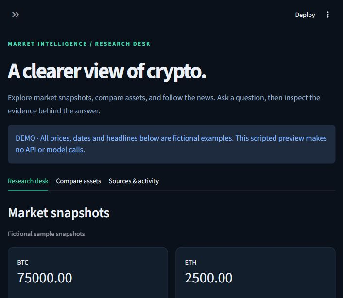
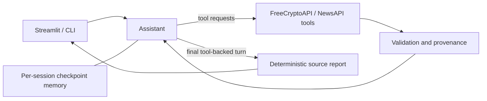

# Crypto Research Agent

A Python crypto research assistant with a LangGraph tool loop, threaded conversations, and a Streamlit research workspace. It retrieves supported coin symbols, market snapshots and news, then renders tool-backed answers with their source values and attribution.



## Run the workspace

Requires Python 3.12+ and [uv](https://docs.astral.sh/uv/).

```powershell
uv sync --locked
uv run streamlit run streamlit_app.py
```

Open the Local URL printed by Streamlit. The workspace starts in **Demo** mode: a scripted, network-free preview with fictional BTC/ETH prices, dates and headlines. It does not use an LLM or require API keys. Try **BTC snapshot**, **Compare BTC / ETH**, then ask for news about the same cryptocurrency.

## Connect live APIs

Copy `.env.example` to `.env` and supply your own credentials:

```dotenv
GROQ_API_KEY=
FREECRYPTO_TOKEN=
NEWSAPI_KEY=
```

Select **Live APIs** in the sidebar. Keys stay on the Python server and are never requested in the browser. Requests consume provider quotas; no API requests run automatically on page load. The model is `openai/gpt-oss-120b` served by Groq. This implementation does not use the OpenAI API.

The UI includes:

- Chat with follow-up context and an explicit new-conversation action.
- Market cards and a comparison table using the latest turn's source results.
- News titles, publishers, publication times and original links.
- Inspectable tool arguments, raw source responses, timing and report download.
- Separate Demo/Live conversations and a fresh conversation after an invocation error.

Each browser session gets a private in-memory checkpoint graph. Memory is lost on reset, mode change, server restart or session expiry. Earlier messages remain in the chat, but earlier quotes are not reused as current dashboard evidence. An asset comparison requests two snapshots; their timestamps may differ.

## Terminal entry points

```powershell
uv run app.py "Give me current market data for BTC."
uv run Ai_app.py
uv run test_memory.py
```

These entry points require configured API keys. `test_api.py` is a manual provider check, not an offline unit test.

## Architecture



`crypto_agent/graph.py` defines the assistant/tools loop. `tools.py` handles providers; `data_quality.py` validates records and filters duplicate/off-topic news; `reporting.py` renders current-turn evidence. `workspace.py` supports the UI and isolated demo fixtures.

## Verify

```powershell
uv run python -m unittest discover -s tests -v
```

Tests mock network and model calls. They cover validation, error handling, attribution, current-turn grounding, memory, and Streamlit interactions. They do not certify provider availability or model tool selection for every prompt.

## Data boundaries

Missing currency, timezone, low/high period and percentage-change baseline remain unspecified unless supplied by the source. There is no historical-price feed, synchronized comparison feed, or price prediction. Headlines alone do not establish why a price moved. Tool-backed final reports are rendered from source results; conversational replies without tool results still come from the model.

The Streamlit app runs on a Python server. Keep `.env` private and use server-side secret management when deploying. This repository currently provides a local app, not a hosted service. Educational research only; not investment advice.
