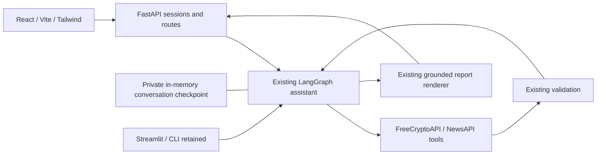

# Crypto Research AI

A source-aware crypto research assistant with a **React + TypeScript** workspace, **FastAPI** transport and the original **LangGraph + Groq** agent. Ask questions, compare source snapshots, follow news, inspect citations and export reports. Light and Dark themes share a compact, responsive interface.

The original Streamlit and terminal applications remain available. The migration changes the presentation and transport layers; the agent graph, providers, tools, validation and report generation are reused.

## Start locally

Requires Python 3.12+, [uv](https://docs.astral.sh/uv/), and Node.js 20+ with npm. The frontend uses Vite 6 to support the workstation's Node 20.12 installation.

**Terminal 1 — backend, from the repository root:**

```powershell
uv sync --locked
uv run uvicorn crypto_agent.api:app --host 127.0.0.1 --port 8000
```

**Terminal 2 — frontend, from the repository root:**

```powershell
cd frontend
npm ci
npm run dev
```

Open [http://127.0.0.1:5173](http://127.0.0.1:5173). The Vite development server proxies `/api` to FastAPI on port 8000. Backend health is available at `/api/health`, and interactive endpoint documentation at [http://127.0.0.1:8000/docs](http://127.0.0.1:8000/docs).

**Demo** uses the existing scripted BTC/ETH fixtures. All sample prices, dates and headlines are explicitly fictional. It requires no API keys and makes no model/provider calls. The sample dashboard preview is separate from conversation history.

## Connect live APIs

Copy `.env.example` to `.env` and add backend credentials:

```dotenv
GROQ_API_KEY=
FREECRYPTO_TOKEN=
NEWSAPI_KEY=
```

Select **Live APIs** in the sidebar. The model is `openai/gpt-oss-120b` served by Groq; no OpenAI API key is used. Live tools call FreeCryptoAPI and NewsAPI. Provider requests consume your quotas and run only after an explicit research action. Live mode never falls back to demo values.

Keep credentials in the root `.env` on the Python server. Never put them in frontend source, a `VITE_*` variable or browser storage. Optional `API_CORS_ORIGINS` configures exact allowed browser origins. The default accepts localhost/127.0.0.1 on ports 5173 and 4173. `frontend/.env.local` may set **only** a public API base URL, e.g. `VITE_API_URL=http://127.0.0.1:8000`, when bypassing the development proxy.

## Workspace behavior

- Chat and research actions invoke the existing LangGraph assistant/tools loop.
- Market, Comparison, News and Browse assets controls call the original tools through dedicated routes, render the existing report, and save their evidence to the same conversation checkpoint. Their explicit parameters are honored directly.
- The current source results populate cards and side panels. Earlier turns keep their own reports and evidence.
- Each conversation owns its checkpoint graph. Demo and Live sessions are isolated and can be restored from Conversations.
- Theme, data mode and selected conversations survive reloads within the same browser tab. Theme is saved locally; workspace/session identifiers use session storage.
- Report downloads return the existing source report as Markdown, with a prominent fictional-data label for Demo.
- Failed invocations reset the affected checkpoint and return a safe error. Network timeouts can leave work running; refresh the conversation before resending a request.

## Checks

```powershell
uv run python -m unittest discover -s tests -v
cd frontend
npm test
npm run build
```

With both development servers running, verify real HTTP/proxy integration using fictional Demo data:

```powershell
cd frontend
npm run test:smoke
```

`npm run preview` serves a production build on port 4173 and also proxies the local API. Unit tests mock external providers. The smoke test exercises Vite → FastAPI, conversation context, comparison, exports and CORS without consuming live quotas.

## Architecture



`crypto_agent/api.py` exposes HTTP routes; `api_service.py` manages process-local sessions and presents source results. `graph.py`, `tools.py`, `data_quality.py` and `reporting.py` retain their original responsibilities. React source lives under `frontend/src/`. See [the migration notes](docs/react-migration.md) for the API contract and design decisions.

## Retained entry points

```powershell
uv run streamlit run streamlit_app.py
uv run Ai_app.py
uv run app.py "Give me current market data for BTC."
uv run test_memory.py
```

Terminal agent entry points require keys. `test_api.py` is a manual provider check, not an offline unit test. The image `docs/workspace-preview.png` shows an earlier Streamlit interface, not the React application.

## Limits

Sessions are **local, single-process memory**, with a four-hour idle expiry and a 100-turn conversation limit. Restarting/reloading the backend loses them. The browser workspace identifier keeps local tab sessions separate; it is not production authentication. Use one backend worker and loopback bindings for local use. Public deployment would require authentication, persistent sessions and resource controls.

The source supplies snapshots rather than historical time series, so no price chart, performance history or Recharts visualization is fabricated. A historical-data integration can add Recharts when genuine chart data exists. Missing quote currency, timezone, measurement period and percentage-change baseline remain unspecified. Headlines do not establish price causation. Tool-backed reports use source results; no-tool conversational replies still come from the model. Educational research only; not investment advice.
